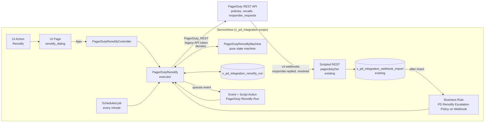
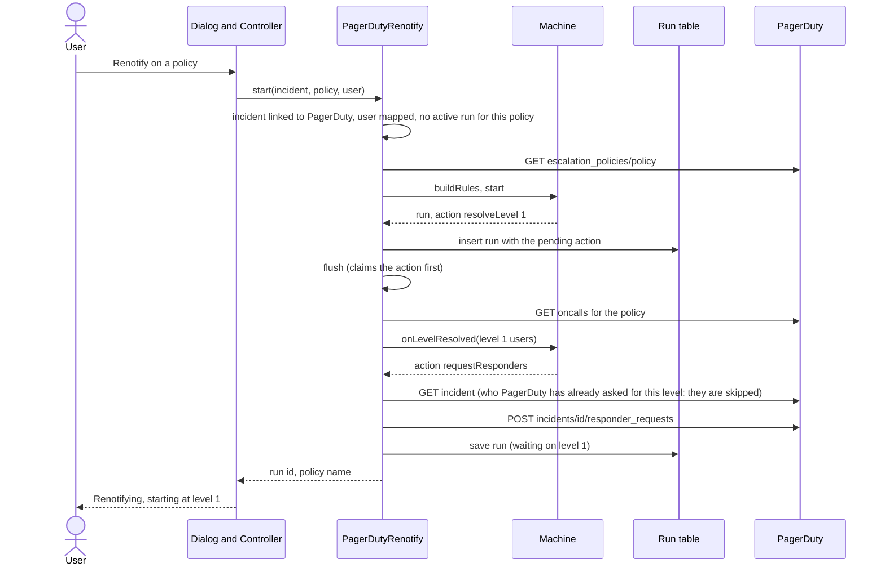
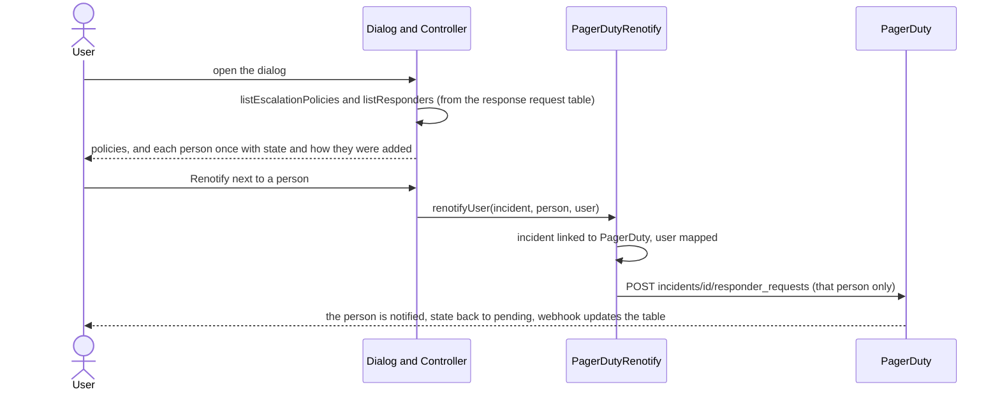
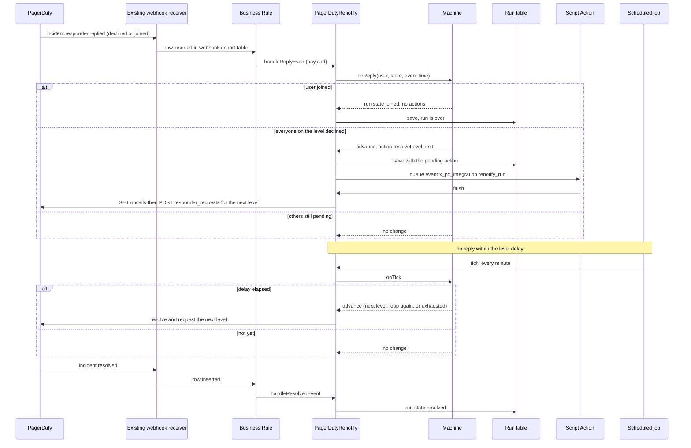
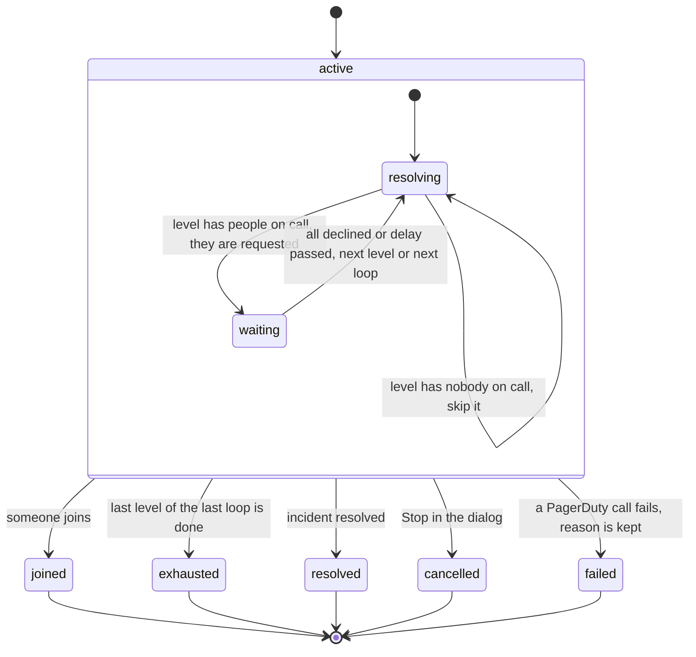
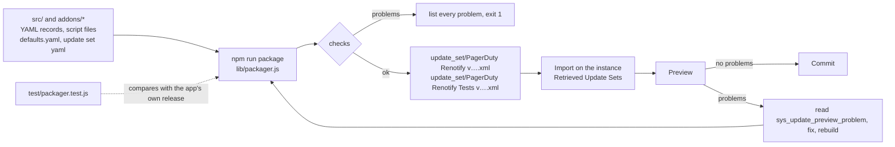

# pd-ep-renotify

Renotify an escalation policy (EP) on a PagerDuty incident from ServiceNow, level by level, as if the EP
were being added for the first time. PagerDuty cannot do this reliably (re-adding an EP only re-requests
level 1), so ServiceNow drives it. See `docs/DESIGN.md` for the behaviour and the PagerDuty findings, and
`docs/adr/0005-…` for the decision.

The goal is an update you can apply over an installed PagerDuty integration: `src/` is an **overlay** on the
`x_pd_integration` scope (new records only, in the integration app's own Update Set YAML layout), so applying it
cannot overwrite a customer's copy of an existing script. Its ATF tests are a second, optional Update Set.

## What it does

On an incident, the **Renotify** button opens a dialog with one list, in two sections: the escalation
policies already added to the incident, and the individuals already added (however they were added). Choose one and its status
appears in a card below the list, with the **Renotify** button to its right (**Stop** for a policy whose run is active). A spinner
shows while the dialog loads. A tag at the top of the card says whether the choice is an escalation policy or an individual, next to its name. Before anything is chosen the card summarises the incident (how many policies and people, and how many
people are pending, joined or declined). For a policy it shows the level and round it has reached, who it is waiting on, when it
started and, if it failed, why; for a person, their state, how they were added and when it last changed. The card keeps updating
while the run proceeds, and a **Full status** disclosure underneath shows every policy and person at once.

Choosing a policy starts a *run*, which does what PagerDuty does when a policy is added for the first time, whatever each person's
earlier answer was:

1. Request the people **currently on call** at level 1 (they go back to *pending*, even if they had declined or joined).
2. If someone **joins**, stop. Nothing else is touched.
3. If everyone requested on the level **declines**, or the level's delay passes with no join, go to the next level
   (on-calls are looked up again at that moment).
4. After the last level, repeat the policy up to its `num_loops`, then stop. The run also stops when the incident is
   resolved, or when the user presses **Stop** in the dialog.

If PagerDuty's own escalation of the policy has already asked someone for a level (a decline moves it on), they are not asked a
second time: the run waits for their answer instead.

Choosing an individual and pressing **Renotify** simply asks that one person again, however they were added. The dialog refreshes
itself while a run is active or someone is pending, and for about 30 seconds after any action (PagerDuty's answer reaches
ServiceNow by webhook a few seconds after the click, and the status says "Request sent, waiting for PagerDuty…" until it does).

## Installing

The one-minute job that advances levels leaves "Run as" blank, like the integration's own PagerDuty refresh jobs, rather than depending on a named user.

Needs from the installed integration app: v3 webhooks including `incident.responder.replied`, the `PagerDuty`, `PagerDuty_REST`
and `AjaxHelper` Script Includes, the response-request and escalation-policy tables, and
`x_pd_integration.enable_response_mobilizer = true` (the same switch as Add Responders).

1. `npm run package` and take `update_set/PagerDuty Renotify v<version>.xml` (see [Build](#build)).
2. On the instance, import it under **Retrieved Update Sets**, **Preview**, and **Commit** once the preview shows no problems.
3. Optional, for testing: import and commit `update_set/PagerDuty Renotify Tests v<version>.xml` the same way (see
   [ATF tests](#atf-tests-optional-package)).

**Authentication.** All calls to PagerDuty go through the app's `PagerDuty_REST`, so they use whichever outbound authentication the
installed app is set up with. With the legacy API token (`x_pd_integration.api_key`) nothing more is needed. With **scoped OAuth**,
the PagerDuty OAuth app must be authorized for `oncalls.read`, which the integration's shipped provider does not request: add it to
the PagerDuty OAuth app and to the provider's scope list on the instance. (`escalation_policies.read`, `incidents.read` and
`incidents.write`, which the remaining calls use, are already requested.) The overlay does not ship that scope itself: the app
blocks save and the healthcheck when a requested scope has not been granted, so adding it would break existing OAuth installs
until they re-authorized. If the scope is missing, a run fails with a message that names it (PagerDuty answers the on-calls request
with 401 or 403), and the dialog shows that message.

## Known limits

- A level's delay is checked by a job that runs every minute, so a timeout can fire up to about a minute late.
- A duplicate text is still possible if PagerDuty's own escalation fires just after our check, or its timing is not aligned with ours.
- Whatever has already been requested stays requested when a run is stopped, resolved or fails; nothing is cancelled in PagerDuty.
- The overlay's two ACLs (dialog and controller) cannot be removed over REST; removing them (and the version history) needs
  `security_admin`.

## How the pieces fit

The Business Rule is the only place the new code meets the existing app's inbound path, and it adds a row-level
hook rather than changing an existing script.

## Sequence: starting a run

## Sequence: renotifying one person

No run is created: the person's answer is theirs to give, and nothing escalates from it.

## Sequence: replies, timeouts and the end of a run

A reply older than the current level's request is ignored, and actions are claimed before any call is made, so a
duplicate webhook delivery cannot request a level twice.

## States of a run

## Layout

| Path | What |
|---|---|
| `lib/renotify.js` | The state machine (pure, no I/O). Source of truth; unit tested. |
| `src/` | The ServiceNow records. `PagerDutyRenotifyMachine.js` is generated from `lib/` by `scripts/sync-to-src.js`: edit `lib/`, run the script, commit both. |
| `addons/tests/` | The optional ATF tests package: a separate Update Set, generated by `tools/atf/generate.js` from `tools/atf/steps/*.js`. Do not edit the generated YAML by hand; the test kit Script Include inside it is hand-written. |
| `test/` | Unit tests for the machine, the executor Script Include against a fake platform, the dialog, the packager, and the ATF step scripts run offline. `npm test` |
| `lib/packager.js`, `scripts/package.js` | The packager that builds the Update Sets. |
| `scripts/` | Project tooling: `package.js` (the packager's command line), `sync-to-src.js`, `learn-types.js`, `compare-update-sets.js`. |
| `docs/` | Design, observed PagerDuty behaviour, packager notes, ADR. |

## Build

`npm run package` builds `src/` and every `addons/<name>/` into `update_set/` (or one directory with `--from=<dir>`).

The packager checks, among other things, that every `$ref` file exists, update names and guids are unique, every
record belongs to the application, and each record's `type` label is one the platform's own exports use for that
table (`lib/known-types.json`, learned from the app with `scripts/learn-types.js`). See `docs/PACKAGER.md`. `npm test` also
compares the packager's output with the integration app's own release when that repo is next to this one.

## Testing

`npm test` runs, without any instance or account:

- the state machine on its own (`test/renotify.test.js`),
- the executor Script Include against a fake record store and a fake PagerDuty (`test/executor.test.js`),
- the dialog in a simulated browser (`test/dialog.test.js`),
- the packager (`test/packager.test.js`),
- the ATF step scripts, offline (`test/atf.test.js`, see below).

### ATF tests (optional package)

The ATF tests ship as their own Update Set, `PagerDuty Renotify Tests v*.xml`, so the overlay itself stays free of test records.
Install the overlay first, then the tests. The suite is **PD: Renotify**, with nine tests:

| Test | What it covers |
|---|---|
| install | The run table and its columns, the Script Includes, the Business Rule, the event, Script Action and tick job, the button and the dialog. Only runs on an instance. |
| machine (3) | The decision logic on its own: levels, joins and declines; timeouts, loops and the end; people PagerDuty already asked. |
| run (4) | The real run table driven through start, replies and timeouts, people PagerDuty already asked, and failures, Stop and single people. |
| webhook | Webhook rows inserted as the inbound handling does, and the Business Rule feeding the run. Covers a join and a resolve only (a decline would queue a real follow-up that calls PagerDuty). |

They need no PagerDuty account, WireMock or waiting: `PagerDutyRenotifyTestKit` builds a `PagerDutyRenotify` on a fake PagerDuty
and a fake clock (the executor takes its collaborators as an optional constructor argument; production passes none). The only records
the tests create are runs and webhook rows of their own, removed again after each test.

Each test is one `tools/atf/steps/*.js` Jasmine script. After changing one, or the manifest in `tools/atf/generate.js`, run
`node tools/atf/generate.js` and commit the generated package files. `test/atf.test.js` runs the very same generated scripts
offline (the real Script Includes and Business Rule, a fake record store and a minimal Jasmine), so a script is known to be sound
before it reaches an instance.

## Status

Version `1.0.0` (the overlay and the tests package are both `1.0.0`).

- **Run behaviour:** exercised on a PDI with a real PagerDuty account, with real SMS replies and with an unattended run of six scenarios (silent
  aliases only; that tooling is not part of this repo), on pre-1.0 builds. Verified: the button and dialog (policies and individuals, names, self-refresh); runs through
  two levels with real replies; the webhook hook; a join ending the run; the person clicking Renotify being asked on behalf of
  another user; no second text when PagerDuty has just asked the same person; timeouts through the one-minute job ending
  `exhausted`; two people on a level; loops; a join by acknowledging; the incident resolving mid-run; Stop; Renotify again after a
  finished run; and Renotify on an individual. All six scenarios passed.
- **Dialog:** the single-list layout was looked at on the PDI. The status card (overview, run details, kind tag), the loading spinner
  and the "Renotify" naming came afterwards and are tested offline only.
- **ATF tests:** all nine pass on the PDI (suite run through the CI/CD API, which needs `sn_atf.runner.enabled` and
  `sn_atf.schedule.enabled` set to `true`; both are `false` by default) and leave no run or webhook rows behind. The offline run was
  checked to fail when the Business Rule, the last-level-exhausted fix or the skip logic is broken. They have not been run against
  the 1.0.0 packages.

Found and fixed along the way: the dictionary record type and name, the on-calls query encoding, PagerDuty ignoring a request a
person makes of themselves, a cancel of PagerDuty's own request that did not hold (replaced by skipping people it has just asked),
a run that timed out on its last level never being saved as `exhausted`, and the dialog showing a stale state after an action.
